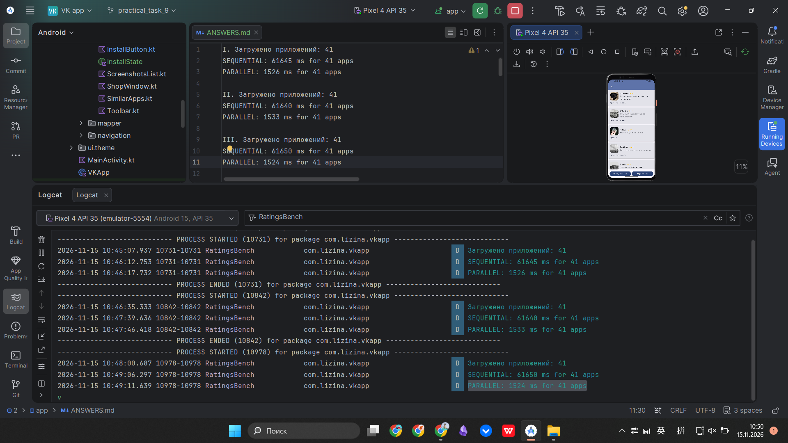

# Практическое задание 9. Асинхронность и корутины в Kotlin

## Задание 1. Отмена установки

Реализовано через `installJob: Job?` в `AppDetailsViewModel`:
- при первом нажатии создаётся джоба в `viewModelScope`, которая эмулирует прогресс
  (`0..100 step 5`, `delay(150)` → 21 итерация ≈ 3.15 с);
- при повторном нажатии во время установки сначала выставляется
  `InstallState.NotInstalled`, затем вызывается `installJob?.cancel()` —
  такой порядок исключает «мигание» прогресса после отмены;
- `CancellationException` пробрасывается наружу, `ensureActive()` вызывается
  перед каждым обновлением состояния — это соответствует structured concurrency;
- при уничтожении ViewModel `viewModelScope` автоматически отменяет джобу.

## Задание 2. Загрузка рейтингов

`VkAppApi.getRating(id)` эмулирует сетевой запрос: `delay(1500)` + случайное значение
из диапазона `(30..50) / 10f`.

Список — **41 приложение** из `/catalog` (задержка 1500 мс на запрос).

### Замеры (`measureTimeMillis`, лог-тег `RatingsBench`)

Выполнено 3 прогона каждой кнопки на одном и том же списке.

| Прогон | Последовательно, мс | Параллельно, мс |
|--------|---------------------|-----------------|
| 1 | 61 645 | 1 526 |
| 2 | 61 640 | 1 533 |
| 3 | 61 650 | 1 524 |
| **Среднее** | **61 645** | **1 528** |

Лог из Logcat:

